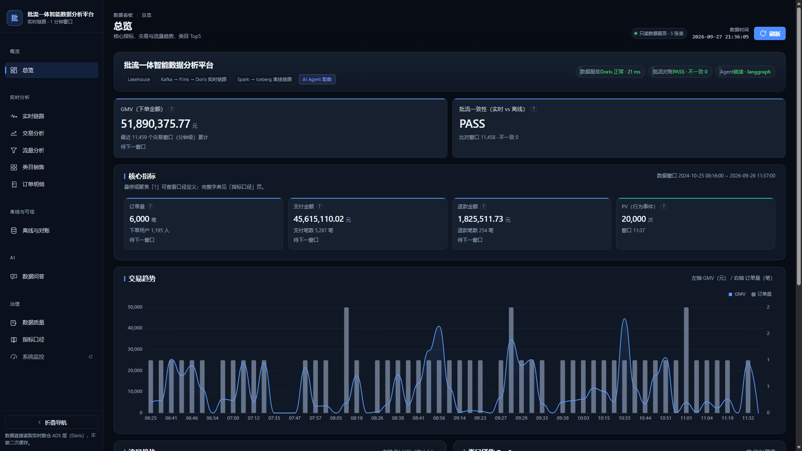
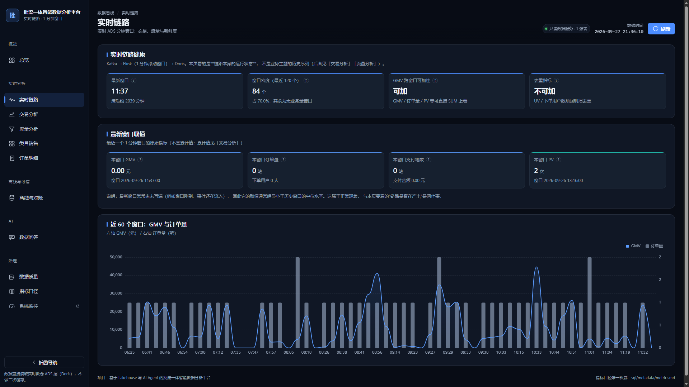
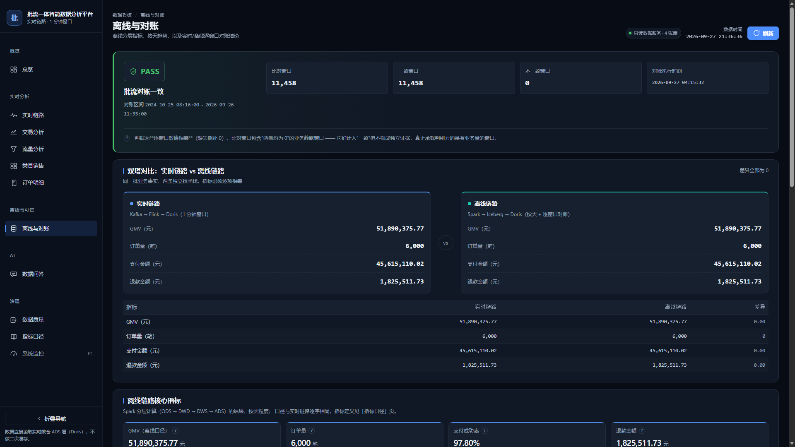
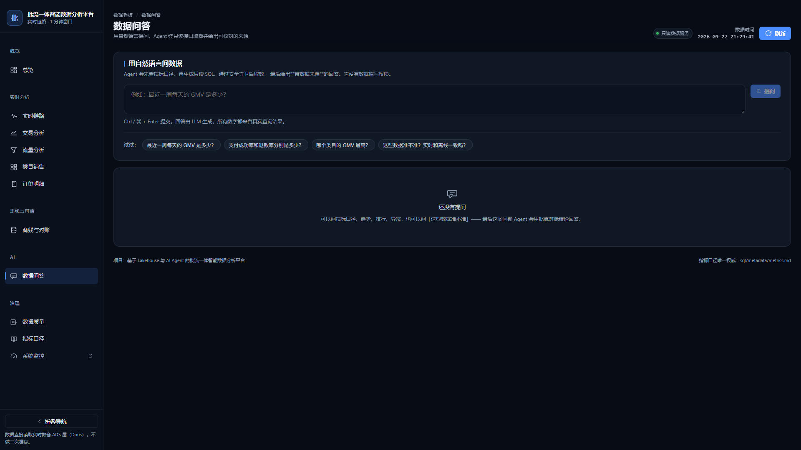
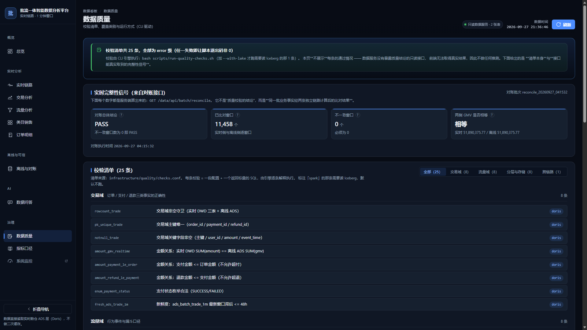

# 基于 Lakehouse 与 AI Agent 的批流一体智能数据分析平台

**项目介绍（面向同学与老师）**

> 学生：蒋树阳　学号：2325010007　学院：前沿交叉学院　班级：大数据 2303
> 指导教师：陈杰　副教授
> 访问地址：**http://36.151.150.140/data/**
> 更新时间：2026-10-23

---

## 一、一句话说清这是什么

> **一个电商业务的数据平台：同一批业务数据，用"实时"和"离线"两条不同的技术链路分别算一遍，
> 再用"逐分钟窗口对账"证明两条链路算出来的数完全一样；在这份可信数据之上，提供看板和自然语言问答。**

它想解决的核心问题只有一个：**同一个指标（比如 GMV），当系统里有两套实现时，你怎么知道它们算的是同一个数？**

---

## 二、为什么需要它：一个真实存在的矛盾

现代数据团队几乎都会遇到这样的局面：

| | 实时链路 | 离线链路 |
| --- | --- | --- |
| 服务对象 | 运营看板，要"秒级" | 报表、分析、复盘，要"准" |
| 技术栈 | Kafka → Flink → Doris | Spark → 数据湖 → 数据仓库 |
| 计算方式 | 流式聚合，窗口一关就出数 | 批处理，每天定时跑 |
| **风险** | **两边各写一遍 SQL，口径一旦分叉，没人发现** |

典型事故长这样：实时看板显示 GMV 120 万，财务报出 118 万，相差 2 万。
查了三天，发现是**实时侧漏了"退款要扣减"这条规则**——两边代码是两个人写的，谁也没错，但口径不一致。

**这个项目的答案不是"用一套引擎统一两边"，而是：承认两条链路都在，用两个机制把它们的口径焊死。**

1. **唯一指标口径文件**：所有指标的定义只有一份（`sql/metadata/metrics.md`），两条链路共用，不允许各自解释。
2. **逐窗口交叉对账**：每天用 Spark 把两边**每一分钟**的指标逐格比对，不一致就报警。

---

## 三、打开网站能看到什么

首页地址：**http://36.151.150.140/data/**

左侧导航按"能力分层"组织，共 **5 组 10 个页面**：

| 分组 | 页面 | 这个页面回答什么问题 |
| --- | --- | --- |
| **概览** | 总览 | 现在生意怎么样？核心指标、交易与流量趋势、类目 Top5 一屏看完 |
| **实时分析** | 实时链路 | 实时链路的分钟级数据还新鲜吗？延迟多少？ |
| | 交易分析 | GMV、客单价、支付成功率、退款率 |
| | 流量分析 | UV / PV、行为漏斗（浏览→点击→加购→收藏→购买）、转化率 |
| | 类目销售 | 哪个类目卖得好？占比多少？ |
| | 订单明细 | 按类目和日期筛选，看单笔订单的支付与退款记录 |
| **离线与可信** | 离线与对账 | 离线算出来的数是多少？**和实时对得上吗（逐窗口对账结论）** |
| **AI** | 数据问答 | 用中文提问（"上个月 GMV 多少"），Agent 取数并给出可核对的来源 |
| **治理** | 数据质量 | 25 条质量校验分别查什么、怎么跑 |
| | 指标口径 | 指标字典与表结构（也是 AI 回答问题的口径来源） |

此外还有两个独立入口：

- **Grafana**（`/grafana/`）：基础设施监控（Prometheus 采集）
- **Airflow**（`/airflow/`）：批处理调度界面，能看到每天的批处理 DAG 运行情况

> **演示建议**：老师看的时候按这个顺序最省时间——
> **总览（30 秒看结论）→ 离线与对账（看核心证据）→ 数据问答（看 AI 能力）→ 指标口径（看治理）。**

---

## 四、数据仓库设计与整体框架

### 4.1 总体架构

```
┌─────────────────── 数据源 ────────────────────┐
│   MySQL 业务库（5 表）        行为事件流(Kafka)  │
│   user / product / orders                     │
│   payment / refund                            │
└────────┬──────────────────────────┬───────────┘
         │                          │
    ┌────▼─────────┐          ┌─────▼─────────┐
    │  离线链路     │          │  实时链路      │
    │  Spark 3.5.7 │          │  Flink 1.20.1 │
    │  按天/按需    │          │  1 分钟滚动窗口│
    └────┬─────────┘          └─────┬─────────┘
         │                          │
    ┌────▼──────────────┐     ┌─────▼──────────┐
    │  数据湖仓 MinIO    │     │ Doris 4.1.4    │
    │  Parquet → Iceberg│     │ 实时 ADS 分钟表 │
    │  Hive Metastore   │     │                │
    └────┬──────────────┘     └─────┬──────────┘
         │  装载到 Doris            │
         └────────────┬─────────────┘
                      ▼
        ┌─────────────────────────────┐
        │  逐窗口批流对账（Spark 作业）  │
        │  只保留"两端都已封窗"的窗口     │
        └──────────────┬──────────────┘
                       ▼
        ┌─────────────────────────────┐
        │  只读数据服务（FastAPI）      │
        └───────┬──────────────┬──────┘
                │              │
        ┌───────▼──────┐  ┌────▼──────────────────┐
        │ Vue 3 看板    │  │ AI Agent（LangGraph）  │
        │ 10 个页面     │  │ 经 MCP 取数、只读、无凭据│
        └──────────────┘  └───────────────────────┘
```

### 4.2 数仓四层分层（ODS → DWD → DWS → ADS）

这是数据仓库的标准分层，每一层职责不同：

| 层 | 全称 | 干什么 | 本项目的表 |
| --- | --- | --- | --- |
| **ODS** | 操作数据层 | 原样落地业务数据，只做格式对齐，不做业务加工 | 6 张：`ods_user` / `ods_product` / `ods_orders` / `ods_payment` / `ods_refund` / `ods_behavior_event` |
| **DWD** | 明细数据层 | 清洗、去重、标准化（枚举统一、类型统一、空值规约） | 6 张：`dwd_user_detail` / `dwd_product_detail` / `dwd_trade_order_detail` / `dwd_trade_payment_detail` / `dwd_trade_refund_detail` / `dwd_traffic_behavior_detail` |
| **DWS** | 汇总数据层 | 按主题轻度聚合（按天、按类目、按用户） | 5 张：`dws_trade_overview_1d` / `dws_trade_category_1d` / `dws_trade_user_1d` / `dws_traffic_overview_1d` / `dws_traffic_funnel_1d` |
| **ADS** | 应用数据层 | 直接供看板/接口查询的最终指标 | 6 张：`ads_batch_trade_1m` / `ads_batch_trade_1d` / `ads_batch_category_1m` / `ads_batch_category_1d` / `ads_traffic_1m` / `ads_traffic_1d` |
| **对账** | 交叉校验 | 存两链路逐窗口比对结果 | 4 张：`ads_reconcile_trade_1m` / `ads_reconcile_summary` / `ads_reconcile_traffic_1m` / `ads_reconcile_traffic_summary` |

**为什么分四层？** 一句话：**越往下游，表越少、越贴近业务；越往上游，表越全、越贴近原始事实。**
这样改口径时只需要动 ADS 一层，不用碰原始数据；查问题时又能一路回溯到 ODS。

### 4.3 两条链路的分工

| | 实时链路 | 离线链路 |
| --- | --- | --- |
| 入口 | Kafka 消息流 | MySQL 业务库 + Kafka 归档 |
| 计算引擎 | **Flink 1.20.1** | **Spark 3.5.7** |
| 结果存储 | **Doris 4.1.4**（实时 ADS 分钟表） | **MinIO 对象存储**（Parquet / Iceberg） |
| 最小粒度 | **1 分钟滚动窗口** | 分钟表 + 天表 + 类目表 |
| 产出速度 | 秒级 | 批处理一次约 33 分钟 |
| 主要用途 | 运营实时监控 | 报表、分析、**作为对账基准** |

**关键设计**：两条链路**共用同一份指标口径**（`sql/metadata/metrics.md`，287 行），
并且**离线侧的结果会被装载回 Doris**，这样看板可以同时展示两边的数并对比。

### 4.4 存储与表格式：为什么要有 Iceberg

这里有个容易被忽略但很重要的点：

| 阶段 | 存储形态 | 能力 |
| --- | --- | --- |
| 数据湖（Parquet + Hive Metastore） | 一堆 Parquet 文件 + 一张元数据表 | 能查，但**没有事务**：写一半失败就是脏数据；不能改结构；不能回查历史版本 |
| **湖仓（Iceberg）** | 在 Parquet 之上加一层"表格式" | **有事务（ACID）**、有快照、能改 schema |

本项目把湖仓里的 **23 张表**迁移成了 **Apache Iceberg 1.10.2**（`format-version=2`，snappy 压缩），
并逐表核对了行数与金额合计。这就是"Lakehouse"这个词在本项目里的真实落点——
**不是"用了对象存储就叫湖仓"，而是"对象存储 + 开放表格式"才叫湖仓。**

### 4.5 指标口径的唯一权威

`sql/metadata/metrics.md` 是**所有指标定义的唯一来源**，规定了三件事：

1. **每个指标怎么算**（公式、分子分母、时间口径）
2. **指标分三类**：可加（GMV、订单数，可以求和）、去重（UV、下单用户数，不能求和）、派生（客单价、转化率，由前两类算出来）
3. **空值怎么处理**（分母为 0 时返回 NULL 而不是 0）

> **为什么要专门强调？** 因为"UV 能不能上卷"这类问题，一旦两条链路理解不同，就会直接导致对账失败。
> 把它写成唯一权威文件，是整个平台可信的地基。

---

## 五、技术栈（版本全部钉死，可复现）

| 类别 | 组件 | 版本 |
| --- | --- | --- |
| 关系库 | MySQL | 8.4.11 |
| 消息队列 | Apache Kafka | 4.2.1 |
| 流计算 | Apache Flink | 1.20.1（Scala 2.12 / Java 17） |
| 批计算 | Apache Spark | 3.5.7 |
| OLAP 引擎 | Apache Doris | 4.1.4 |
| 对象存储 | MinIO | RELEASE.2025-10-15T17-29-55Z |
| 元数据 | Hive Metastore | 3.1.3 |
| 表格式 | Apache Iceberg | 1.10.2 |
| 调度 | Apache Airflow | 3.3.2 |
| 数据服务 | FastAPI | ≥0.115 |
| AI 编排 | LangGraph / MCP | 1.1.0 / 2.2.0 |
| 监控 | Prometheus / Grafana | v3.13.3 / 13.2.2 |
| 前端 | Vue 3 / ECharts | 3.5.13 / 5.6.1 |

> 全部写成明确的版本号，**没有一个 `latest`**。这是可复现的前提。

---

## 六、凭什么说它"可信"：三个层次的证据

这是本项目与一般课程设计最大的区别——**结论不是"功能演示通过"，而是"可复核的断言"**。

### 证据一：逐窗口对账（核心）

不是"总数差不多"，而是**每一分钟逐一比对**：

| 检查项 | 实测结果 |
| --- | --- |
| 交易域对账窗口数 | **11458 个分钟窗口**（两侧各 11458） |
| 交易域不一致窗口 | **0** |
| 交易域单边窗口（只有一侧有数据） | **0 / 0** |
| 两侧 GMV 合计 | **51,890,375.77 == 51,890,375.77**（精确到分相等） |
| 流量域对账窗口数 | **19643 个分钟窗口** |
| 流量域不一致窗口 | **0** |
| 流量域单边窗口 | **0 / 0** |

**比对的是什么？** 交易域是 **7 个可加指标 + 1 个去重指标**（`order_user_cnt`）；
流量域是 **7 个判据列**（UV、PV、浏览、点击、加购、收藏、购买）。

**边界说清楚**（这点很重要，不能含糊）：

- 结论**只在对账区间内**成立（区间由两侧数据范围求交、尾部留 3 分钟安全边界得到）
- 缺失的一侧**补 0** 后比较
- 11458 个窗口中有 **5504 个两侧 GMV 均为 0**，属于"平凡一致"，
  真正承载判别力的是**其余 5954 个有业务量的窗口**

### 证据二：数据质量校验

**25 条校验**，覆盖行数、非空、唯一性、枚举合法性、金额关系、跨层一致性、新鲜度等。
而且支持**故意制造失败**来验证校验器本身有效（`--proof-fail` 两次都以退出码 1 结束）。

### 证据三：自动化测试

**434 个测试全部通过**（单元 296 + 冒烟 138），包括：

- SQL 守卫的对抗性测试（试图用逗号连接、子查询等方式绕过表白名单）
- 跨模块表名提取一致性测试
- 前端质量清单与后端校验配置的一致性测试

---

## 七、AI 问答：可信性来自架构，不是来自提示词

这是项目的另一个差异化点。很多"接入大模型"的作品，问题是**回答无法核对**。本项目用了四个设计：

| 设计 | 具体做法 |
| --- | --- |
| **进程边界** | Agent 进程里**没有数据库密码，也没有数据库客户端**。它只能通过 HTTP 调用只读数据服务 |
| **只读账号** | 数据服务连数据库用的是只读账号 `agent_ro`，写操作会被数据库直接拒绝（实测 `DELETE` → 403） |
| **SQL 守卫** | 服务端强制白名单表 + 只允许 SELECT + 强制 LIMIT；**逗号连接绕过**这类攻击会被拦截 |
| **可核对来源** | 每次回答附带：实际执行的 SQL、命中的口径文档（**带文件名和行号**）、用到了哪些表 |

**工作流程**：`检索口径 → 规划 → 取数 → 校验 →（失败则反思重试）→ 汇总`

其中"反思重试"是**真实触发过的**：遇到 Doris 报错（`DORIS_QUERY_ERROR_1105`，用了不存在的列名）时，
Agent 反思后重新规划并成功取数（`retries=1`）；也有 `retries=2` 后**拒绝作答、没有编造数字**的记录。

---

## 八、当前数据规模

> 说明：当前使用的是**可复现的模拟数据集**；后续将迁移为真实公开数据集，届时下列数字会更新。

| 项 | 当前值 |
| --- | --- |
| 时间跨度 | 2024-10-25 ~ 2026-09-26 |
| 订单 | 6000 单 |
| GMV | 51,890,375.77 元 |
| 支付 | 5287 笔 / 45,615,110.02 元（失败 119 笔） |
| 退款 | 254 笔 / 1,825,511.73 元 |
| 行为事件 | 20000 条（UV 1200 / PV 20000） |
| 行为分布 | 浏览 10472 / 点击 5759 / 加购 2095 / 收藏 1046 / 购买 628 |
| 交易窗口 | 11459 个分钟窗口 |
| 流量窗口 | 19644 个分钟窗口 |
| 类目窗口 | 5998 |
| 类目 Top3 | 电脑办公 15,457,835.79 元 / 家用电器 9,695,186.17 元 / 手机数码 9,421,344.18 元 |

---

## 九、怎么演示（给同学的 5 分钟版本）

1. **打开总览页**：一句"这就是一个电商数据平台，实时和离线两套都算好了，而且对得上"
2. **点"离线与对账"**：展示 11458 / 19643 个窗口、不一致 0、两侧 GMV 精确到分相等 —— 这是核心
3. **点"数据问答"**：问一句"GMV 是多少"，展开来源，指出附带的 SQL 和命中的口径行号
4. **点"指标口径"**：说明指标定义只有一份，两条链路共用
5. **点"数据质量"**：说明 25 条校验，且验证过校验器本身会失败

---

## 十、已知限制（主动交底）

诚实说明比夸大更安全，以下都写在论文的"不足"章节里：

1. **数据是模拟的**：当前数据由确定性生成器产生（固定随机种子），保证可复现；正在迁移为真实公开数据集
2. **对账只覆盖区间内**：区间外数据未比对；交易域没有"单边窗口必须为 0"的硬断言
3. **Iceberg 验证范围有限**：核对的是表目录、行数、金额合计三个维度；时间旅行、回滚演练未验证
4. **实时侧有 1 个窗口的派生比率列存在缺陷**：已定位、已留证、判据已改严，经成本评估后决定不修
5. **性能数据是单机回环**：4 核 16 GB、无并发、热缓存，不代表生产规模
6. **未做并发与高可用**：单机部署，不是生产级集群

---

## 十一、界面一览

**① 总览页**：核心指标、批流对账状态、类目 Top5



**② 实时链路页**：分钟级窗口的新鲜度与实时指标



**③ 离线与对账页**：核心证据页，展示逐窗口对账结论



**④ 数据问答页**：自然语言提问 + 可核对的来源



**⑤ 数据质量页**：25 条校验清单



---

## 附录：接口清单

### 数据服务（15 个）

| 方法 | 路径 | 用途 |
| --- | --- | --- |
| GET | `/health` | 健康检查 |
| GET | `/overview` | 首页总览（KPI + 窗口数 + 类目 Top） |
| GET | `/metrics/trade` | 交易域指标 |
| GET | `/metrics/traffic` | 流量域指标 |
| GET | `/metrics/category` | 类目指标 |
| GET | `/funnel` | 行为漏斗 |
| GET | `/orders` | 订单列表 |
| GET | `/orders/{order_id}` | 订单详情 |
| GET | `/categories` | 类目列表 |
| GET | `/meta/metrics` | 指标口径文档 |
| GET | `/meta/tables` | 表结构 |
| POST | `/query` | 自定义只读查询（经 SQL 守卫） |
| GET | `/batch/overview` | 离线链路指标 |
| GET | `/batch/reconcile` | **批流对账结论** |

### AI Agent（9 个）

| 方法 | 路径 | 用途 |
| --- | --- | --- |
| GET | `/health` | 健康检查 |
| GET | `/tools` | 可用工具清单 |
| GET | `/prompt` | 系统提示词（可审计） |
| GET | `/graph` | LangGraph 流程图结构 |
| GET | `/mcp` | MCP 连接状态 |
| GET | `/retrieval` | 检索后端信息 |
| GET | `/api/retrieve` | 口径检索 |
| POST | `/ask` | **自然语言问答** |

---

*文档结束。如需更深入的技术细节，见论文正文与 `docs/sprint/` 下的 13 份开发记录。*
